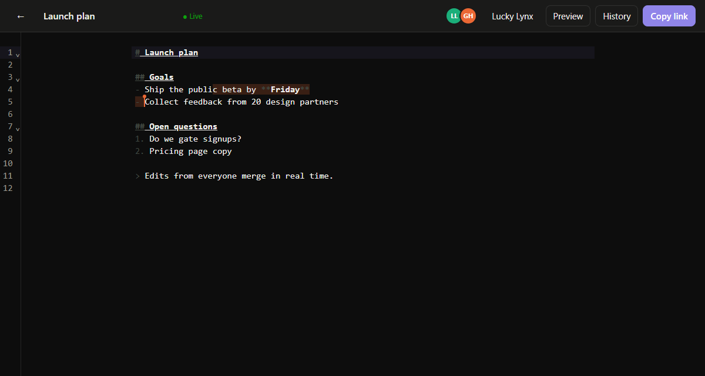

# Inkwell

[](https://github.com/timmichael738/inkwell/actions/workflows/ci.yml)


**A real-time collaborative Markdown editor.** Open a document, share the link, and write together:
everyone's cursor and selection shows up live, edits merge without conflicts (even after being
offline), and named versions let you roll back.



## How it works

```text
 browser A ─┐   y-websocket protocol (binary)    ┌──────────── server ────────────┐
 CodeMirror │ ── sync step 1/2 · updates ──────▶ │ Room = Y.Doc + Awareness       │
 + Yjs      │ ◀─ updates · awareness ─────────── │   ├─ fan-out to other sockets  │
 browser B ─┘                                    │   └─ append update → SQLite    │
                                                 └────────────────────────────────┘
```

- **CRDT, not locking.** Each client holds a [Yjs](https://yjs.dev) document. Edits are CRDT
  updates that commute, so concurrent typing from any number of people (or edits made offline)
  always converges to the same text, with no server-side merge logic or "someone else is editing" locks.
- **A hand-written sync server.** The server implements the standard y-websocket protocol
  (sync step 1/2, updates, awareness) with `y-protocols`. Any Yjs client can connect to it.
- **Presence.** The awareness protocol carries each user's name, color and cursor. `y-codemirror.next`
  renders remote cursors and selections. When a socket drops, its presence is removed immediately.
- **Persistence.** Each update is appended to SQLite (`node:sqlite`). Past 200 rows, the log is
  compacted into a single merged update in one transaction. Rooms load on first connect and
  unload when idle.
- **Versions.** Saving stores a full snapshot. Restoring applies the old text as a _new_ edit, so
  every collaborator sees it live and history is never rewritten.

## Features

- Live multi-user editing with colored remote cursors and a presence bar
- Connection status; edits made while offline sync automatically on reconnect
- Markdown preview, sanitized with DOMPurify so collaborators can't inject scripts
- Undo/redo that only affects _your_ changes (Yjs `UndoManager`)
- Named version history with live restore
- Unguessable document links (72-bit random ids) and a 2 MB WebSocket frame limit

## Quick start

```bash
npm install
npm run dev        # server :4100, UI http://localhost:5173
```

Open the same document in two windows to see collaboration in action. Or run it with Docker:

```bash
docker compose up --build   # http://localhost:4100
```

## Testing

```bash
npm test
```

The integration tests start the real server and connect **real Yjs clients over WebSockets**.
They cover convergence of concurrent edits, presence add/remove, persistence across room unloads
(a "restart"), live version restore, log compaction, and rejection of unknown documents.

## Project structure

```text
shared/types.ts        Shared types and validation
server/src/
  rooms.ts             Room (Y.Doc + awareness + sockets) and RoomManager (load/unload)
  store.ts             SQLite: documents, append-only update log, compaction, versions
  app.ts               REST API + WebSocket endpoint
web/src/
  components/Editor.tsx    CodeMirror 6 + y-codemirror.next + WebsocketProvider
  components/History.tsx   Version list, save and restore
  identity.ts              Random friendly names and cursor colors
```

## Limitations

Documents are link-shared (anyone with the link can edit), and there are no accounts. The
next steps would be authentication on the WebSocket upgrade and per-document permissions.

## License

[MIT](LICENSE) © Michael Timothy
